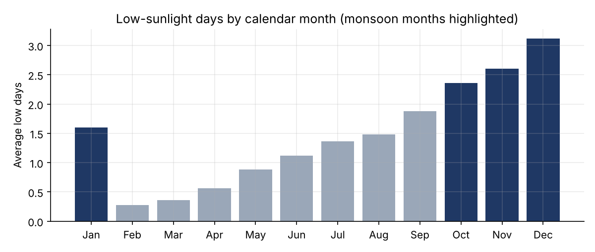
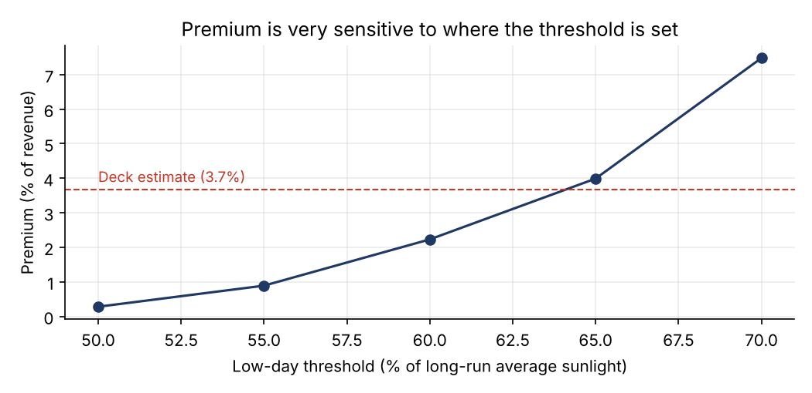

# SolarGuard LSS: pricing parametric solar insurance with 25 years of NASA satellite data

**Dylan Ambrose Amerton** · Actuarial Studies, Sunway University · [LinkedIn](https://linkedin.com/in/dylan-ambrose-amerton)

In a university group project, our team designed *SolarGuard LSS*: parametric insurance that pays Malaysian large-scale solar (LSS) farms when cloudy weather cuts their revenue. The payout depends on how many **low-sunlight days** a month has. We priced it with **placeholder probabilities**.

This project replaces those guesses with **9,131 days of satellite sunlight data (2001–2025)** for a site in Kedah, and reprices the product.

## Key results

| | Group deck (guessed odds) | NASA data (2001–2025) |
|---|---|---|
| Months triggering Tier 1 (5–7 low days, 20% payout) | 6.0% | **6.3%** |
| Months triggering Tier 2 (8–14 low days, 45% payout) | 2.5% | **1.0%** |
| Months triggering Tier 3 (15+ low days, 100% payout) | 0.5% | **0.0%** (max seen: 10 days) |
| Expected payout per year | RM456k | **RM277k** |
| Premium at 1.30× loading | RM593k (3.7% of revenue) | **RM360k (2.2% of revenue)** |

**1. The deck overpriced the cover by about 40%.** The small payout tier was guessed well, but the larger tiers trigger far less often than assumed.

**2. Cloudy days cluster, and an independent-days model badly underprices the risk.** Treating each day as an independent coin flip predicts a payout in 1.35% of months. The data shows **7.33%, about 5.4× more**. Most of this comes from the northeast monsoon: **20 of the 22 triggering months fell between October and January.**

**3. The price is very sensitive to the trigger threshold.** Moving the "low day" definition from 60% to 65% of average sunlight almost doubles the premium (2.2% → 4.0% of revenue).

**4. The annual limit is comfortably sized.** The worst year (2025) would have paid RM808k, 20% of the RM4.04M cap. 10 of the 25 years paid nothing.





## Method

1. **Data:** daily all-sky surface irradiance (`ALLSKY_SFC_SW_DWN`, kWh/m²/day) from [NASA POWER](https://power.larc.nasa.gov/) at 5.81°N, 100.47°E.
2. **Trigger:** a day is "low" if irradiance is below **60% of the site's long-run average** (3.03 kWh/m²/day).
3. **Replay:** count low days in each of the 300 months and apply the payout tiers to a 50 MWac plant (monthly sum insured RM1.35M).
4. **Price:** expected annual payout = 12 × Σ (tier probability × payout share) × sum insured; premium = 1.30 × expected payout.
5. **Checks:** compare with a binomial (independent days) model, measure day-to-day correlation and seasonality, and test five threshold levels.

## Limitations

- **One site.** Real cover would be calibrated plant by plant; east-coast sites face a stronger monsoon.
- **The extreme tier cannot be priced from 25 years alone.** No month reached 15 low days, but that does not make the risk zero. A real price would add a margin or fit a tail distribution.
- **Basis risk.** A satellite grid cell is not the same as on-site panel output.
- **Climate change.** The past 25 years may not represent the next 10.

## Project structure

```
solarguard/core.py                       product logic: thresholds, tiers, pricing, checks
notebooks/solarguard_calibration.ipynb   the full analysis, with charts
tests/test_core.py                       12 unit tests (pytest)
data/                                    NASA POWER daily data, 2001–2025
figures/                                 charts produced by the notebook
```

## Run it yourself

```bash
pip install -r requirements.txt
pytest                                   # run the tests
jupyter notebook notebooks/solarguard_calibration.ipynb
```

Or [open the notebook in Google Colab](https://colab.research.google.com/github/DylanAmbrose892/solarguard-calibration/blob/main/notebooks/solarguard_calibration.ipynb). It downloads the data from NASA automatically if `data/` is missing.

*Product parameters (50 MWac plant, 1,900 MWh/MWac yield, RM0.17/kWh tariff, payout tiers, 1.30 loading) come from the SolarGuard LSS group presentation. This is an academic exercise, not a commercial price.*
