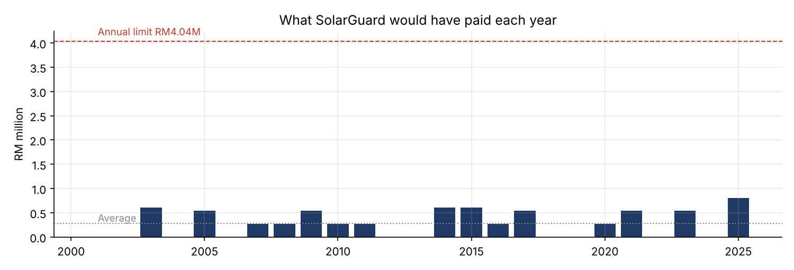

# SolarGuard Calibration

Pricing a parametric insurance product for Malaysian large-scale solar farms using 25 years of NASA satellite data.

Dylan Ambrose Amerton, Actuarial Studies, Sunway University

[Notebook](notebooks/solarguard_calibration.ipynb) | [Run in Google Colab](https://colab.research.google.com/github/DylanAmbrose892/solarguard-calibration/blob/main/notebooks/solarguard_calibration.ipynb)

## Background

In a university group project, our team designed SolarGuard LSS, a parametric product that pays a solar farm when cloudy weather cuts its revenue. A month pays out according to how many low-sunlight days it has: 20% of the monthly sum insured for 5–7 days, 45% for 8–14 days and 100% for 15 or more. The original pricing used placeholder probabilities for each tier. This project replaces them with observed data.

## Data

Daily all-sky surface irradiance (`ALLSKY_SFC_SW_DWN`, kWh/m²/day) from [NASA POWER](https://power.larc.nasa.gov/) for 5.81°N, 100.47°E (Kedah), 1 January 2001 to 31 December 2025: 9,131 days, none missing.

A day counts as low if irradiance is below 60% of the site's long-run average, which is 3.03 kWh/m²/day.

## Results

| Source | Tier 1 | Tier 2 | Tier 3 | Expected payout | Premium | Premium / revenue |
|---|---|---|---|---|---|---|
| Group deck (assumed) | 6.0% | 2.5% | 0.5% | RM456k | RM593k | 3.7% |
| NASA data, 2001–2025 | 6.3% | 1.0% | 0.0% | RM277k | RM360k | 2.2% |

*Tier columns show the share of months that trigger each tier. Premium is expected payout × 1.30. Example plant: 50 MWac, annual revenue RM16.15M, monthly sum insured RM1.35M.*

The deck's estimate for the smallest tier was close, but the larger tiers trigger much less often than assumed, so the data-based premium is about 40% lower.

Low-sunlight days cluster. If each day were independent, 5 or more low days would occur in 1.35% of months; the data shows 7.33%. Most of the clustering is seasonal: 20 of the 22 months that triggered a payout fell between October and January, during the northeast monsoon.

The premium is sensitive to where the threshold is set:

| Threshold (% of average) | 50% | 55% | 60% | 65% | 70% |
|---|---|---|---|---|---|
| Premium / revenue | 0.3% | 0.9% | 2.2% | 4.0% | 7.5% |

Over the 25 years, the worst year (2025) would have paid RM808k, about 20% of the RM4.04M annual limit, and 10 years paid nothing.




## Limitations

- One site only. Real cover would be calibrated for each plant, and east-coast sites face a stronger monsoon.
- No month in the data reached 15 low days, so the Tier 3 probability cannot be estimated from this record alone. A real price would add a margin or fit a tail distribution.
- Basis risk: a satellite grid cell does not match on-site panel output exactly.
- The past 25 years may not represent future climate.

## Structure

```
solarguard/core.py                       product logic: threshold, tiers, pricing, checks
notebooks/solarguard_calibration.ipynb   analysis and charts
tests/test_core.py                       unit tests
data/                                    NASA POWER daily data, 2001–2025
figures/                                 charts
```

```
pip install -r requirements.txt
pytest
jupyter notebook notebooks/solarguard_calibration.ipynb
```

Product assumptions (plant size, 1,900 MWh/MWac yield, RM0.17/kWh tariff, payout tiers, 1.30 loading) come from the group presentation. This is an academic exercise, not a commercial price.
